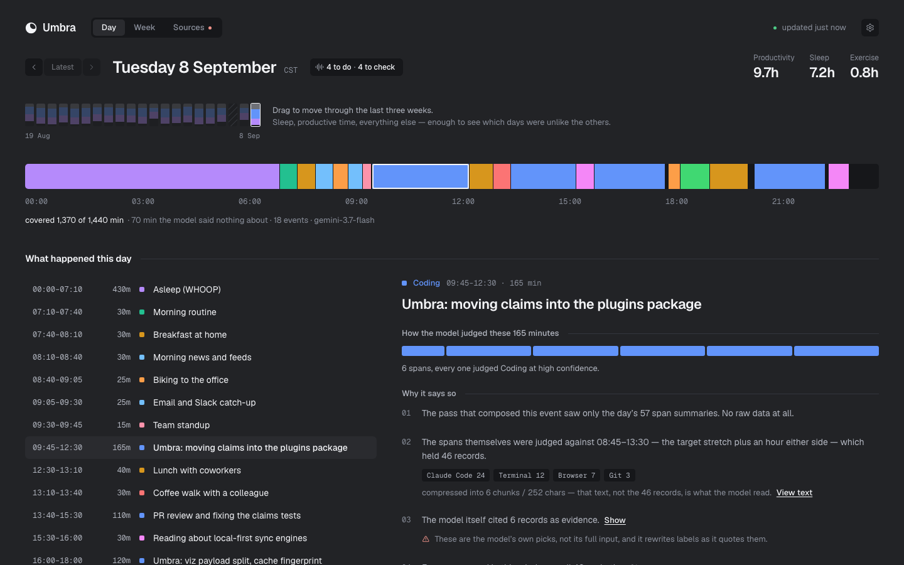
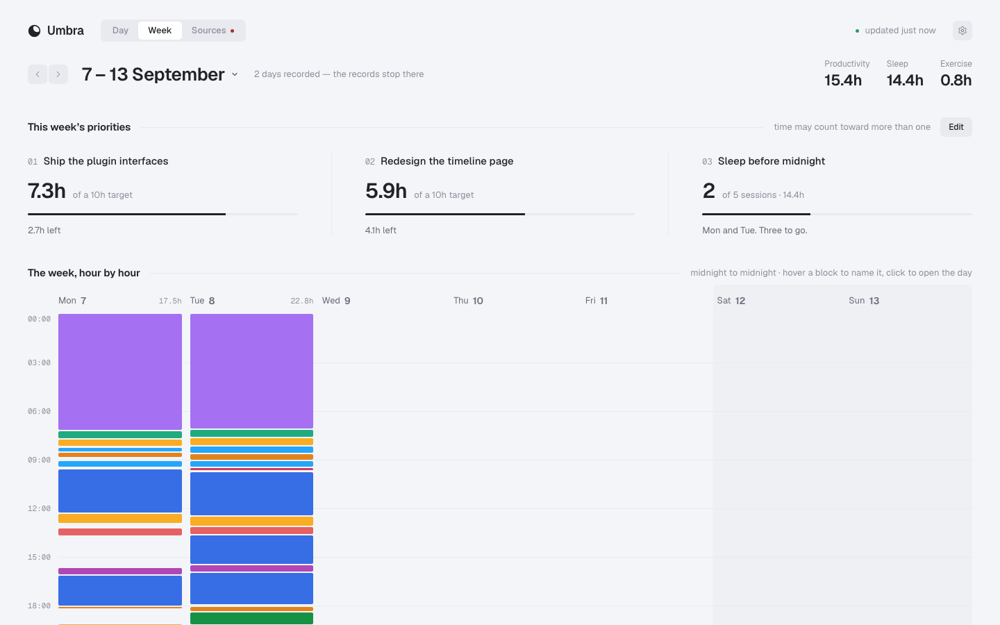
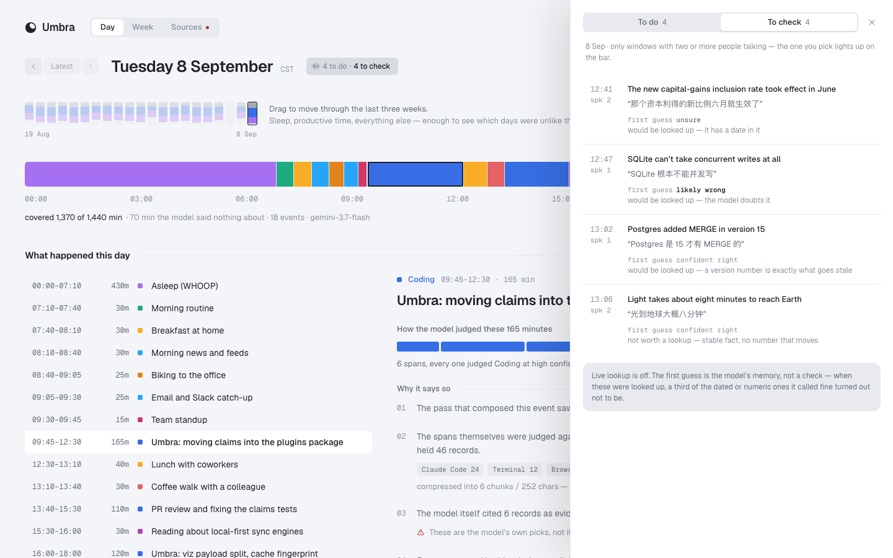
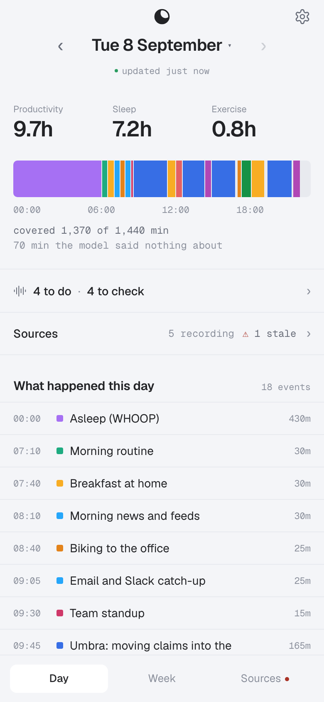

<p align="center">
  <picture>
    <source media="(prefers-color-scheme: dark)" srcset="docs/images/logo-dark.svg">
    
  </picture>
</p>

<h1 align="center">Umbra</h1>

<p align="center">
  <a href="https://github.com/sherwinx/umbra-time-tracker/actions/workflows/test.yml"></a>
</p>

Pull your scattered digital footprints onto one timeline, and let an AI
reconstruct **what you were actually doing all day** — sleep, commutes,
meetings, deep work, doomscrolling — as auditable calendar events.

Everything runs locally. One SQLite file. Zero dependencies beyond the
Python standard library. Your data never leaves your machine except for
the model calls you explicitly configure.

```
sources (13 built-in + your own plugins)
   └─→ events.db (append-only point events)
         ├─→ rule-based 5-minute blocks        offline, no network
         ├─→ LLM inference: spans → calendar events   any model you configure
         └─→ the page: day / week / sources, with full drill-down to raw evidence
```

## Who it's for

Someone on a Mac who wants an honest record of where their days go, and is
at home with a terminal, an API key and a config file. Umbra is a tool you
run, not a service: it reads what is already on your machine (and the
accounts you connect), and a model you choose turns that into a calendar.

How much of the day it can see depends on what you connect:

| tier | sources | what it asks of you | what it sees |
|---|---|---|---|
| 1 · this Mac, no setup | chrome, claude, zsh, git | nothing (git: name your repo folders) | time at the keyboard — on its own, expect about two-thirds of a day to read *Unknown* |
| 2 · macOS permissions | app, iphone, media, intent; the live collector | Full Disk Access for the scheduled job; Accessibility for the collector | every app in front, on the Mac and on an iPhone under the same iCloud account; what you listened to |
| 3 · devices and accounts | whoop, plaud, location, weread | the device or account, and a one-time authorisation each | the time away from screens: sleep, conversations, where you were, reading |

A source you have not set up stands aside and is listed as *Not set up* —
it is never a failure. `umbra sources` says what each one is missing.

## Quick start

```bash
uv tool install git+https://github.com/sherwinx/umbra-time-tracker   # or: pipx install ...

umbra sources          # what can be collected on this machine, what's missing
umbra import           # pull everything (incremental, idempotent)
umbra serve            # the page, live on localhost (opens in browser)
umbra viz              # the same page as one self-contained file
umbra export --out DIR # …or as a static site, read-only — what the phone reads
umbra infer 2026-08-17 # let a model judge the day (needs an API key)
umbra sync             # import → infer → page in one idempotent command
umbra schedule install # run sync every 6 h via launchd/systemd
```

Keys (`GEMINI_API_KEY`, `WHOOP_CLIENT_ID`, …) go in `~/.config/umbra/env`
as `KEY=value` lines; umbra loads it itself, scheduled runs included. The
scheduled job runs the same interpreter you installed umbra with; for the
tier-2 sources, grant Full Disk Access to the file `umbra doctor` names.

Requires Python 3.11+. Hacking on a clone? `python3 -m umbra …` is the
same thing. The backfill path is stdlib-only; the live collector (window
titles, clipboard, input idle) needs PyObjC on macOS
(`uv tool install "umbra-time-tracker[collector] @ git+https://github.com/sherwinx/umbra-time-tracker"`).
The page ships pre-built, so using Umbra needs neither Node nor Bun. The
one exception is PLAUD: its authorisation comes from PLAUD's own CLI
(`npm i -g @plaud-ai/cli && plaud login`), so connecting a recorder needs
npm once; Umbra renews the token after that.

**Just want to look?** No API key and no data of your own needed:

```bash
python3 -m umbra.devseed /tmp/umbra-demo
UMBRA_DATA_DIR=/tmp/umbra-demo UMBRA_CONFIG_DIR=/tmp/umbra-demo umbra serve
```

That writes three synthetic weeks (judged days, an unjudged one, a day
whose model calls failed, a source that stopped importing) and opens the
page on them. Nothing on your machine is read.

## The page



**Day** — the 24-hour bar of what the model decided you were doing, the
three weeks around it (drag to move through them), and the day as a list
of events. Pick one and it shows how it came to be said: the spans it was
composed from, the text the model actually read, the records it cited, and
every raw record in the window. Time the model said nothing about is left
blank, never painted over; a day no model has looked at is hatched, not
empty; a window whose call failed says so.

**Week** — the week hour by hour, where the time went against the same
days last week, and up to three priorities with a target each. Which time
counts toward a priority is the model's call (it reads the day), not a
category rule.



**Sources** — every source, grouped by what it needs from you: the ones
that stopped, the ones recording, the ones whose permission can't be
probed (and say so instead of showing a tick), the ones not set up.

**Said aloud** — if you wear a recorder, what you said you'd do and what
you claimed as fact, each pinned to the 30-minute window it came from
(see [Voice-dispatched tasks](#voice-dispatched-tasks) and
[Fact-checking](#fact-checking-what-you-said)). Mark a to-do done or not a
task, or a claim seen, right there; a closed one stays listed, faded.



**Settings** — language, theme, schedule, plugins, model and publishing.
Every control writes one line of `config.toml` and keeps your comments;
structures (providers, categories, deploy) stay "Open in editor".

Light and dark follow the system, or `[ui] theme`. Category colours are
generated from a rule, not picked — a category you add gets its own
colour the same way.



### Three ways to open it

| | what you get | where it's for |
|---|---|---|
| `umbra serve` | the page, live, on `127.0.0.1:5170` | your Mac — the only form that can change settings, priorities, or start an import |
| `umbra viz` | one self-contained file; every scheduled run rewrites it | double-click, offline, a backup — it still works copied elsewhere |
| `umbra export --out DIR` | a static, read-only site | your phone, through your own host |

`umbra serve` binds localhost only and refuses writes that don't come from
the page itself. It never listens on the network unless you ask for it by
name (`--host`), because what it serves is your whole raw history.

### On your phone

The phone gets the exported site, not `umbra serve` over the network:
set `[deploy] command` and every scheduled run exports and uploads it
(`{dir}` is the directory to publish — Cloudflare Pages, Netlify, rsync,
S3 all take one). Below 640px the page switches to its phone layout. It
is read-only: everything that writes is shown, disabled, and says it is
done on the Mac.

⚠️ The export carries your raw history. **Put authentication in front of
it before the first deploy** (Cloudflare Access, Netlify Identity, …) —
a static file scraped once cannot be recalled. Paths from your Mac are
written as `~/…`.
<br clear="right">

## What it collects

| source | from | what it knows |
|---|---|---|
| chrome | Chrome History SQLite | URLs, titles, dwell time |
| claude | ~/.claude session logs | what you asked AI = what problem you were solving |
| zsh / git | shell history, repo logs | terminal commands, commits |
| app | knowledgeC.db (macOS, FDA) | foreground app sessions |
| iphone / media / intent | Biome (macOS, FDA) | phone foreground app, what you listened to, messages/calls (actions only) |
| whoop | WHOOP API | sleep, workouts, recovery |
| location | your own Overland → Worker relay | stays and transits (no raw coordinates stored) |
| plaud | PLAUD API | what you said out loud, with timestamps |
| weread | WeRead API | reading sessions and highlights |
| butler | your own agent-task service | AI agent task history |

Every source is a plugin: a single Python file with a
`collect(since_ms)` function. Drop your own into
`~/.config/umbra/sources/` — see [docs/writing-a-source.md](docs/writing-a-source.md).

## Models

Zero config uses Gemini (`GEMINI_API_KEY`); `gpt-*` and `claude-*` models
work the same way with `OPENAI_API_KEY` or `ANTHROPIC_API_KEY`. Any
OpenAI-compatible endpoint works too — Ollama, vLLM, llama.cpp, Fireworks —
via one config block; see [config.example.toml](config.example.toml).
Judgements are stored per model, so you can compare models on the same day.
A plugin can run on its own model (`[plugins.<name>] model = "…"`).

Inference is incremental: a window is only re-sent to the model when its
input digest actually changed. Re-running an unchanged day costs zero
API calls.

## Correcting the day

Some hours leave no record — reading on a separate e-reader, a walk without
the phone — and the model can only guess at them. Open any event (or a stretch
the model said nothing about) and press **✎ Correct**: pick the category, add a
note if you like. The page shows yours at once and marks it ✎; the next round
re-reads only the windows it covers, with your words in front of the model, and
the panel says whether the model has re-read it and whether it agrees. What the
model said before stays alongside, and **Undo** takes a correction back. From a
terminal: `umbra correct 2026-09-12 18:00-19:00 read "reading over dinner"`, and
`umbra correct --list 2026-09-12`.

## Honesty rules

This project's core discipline is never letting these pairs look the same:

- "no data" vs "data not imported yet"
- "the model said nothing" vs "we failed to parse the model"
- "nothing happened" vs "sources disagree about what happened"
- an inferred guess (◇) vs a measured fact vs a known blind spot (ⓘ)

Every calendar event drills down to the spans that composed it, the
exact text the model read, the records the model cited, and every raw
record in the window. No un-auditable conclusions.

## Voice-dispatched tasks

This and fact-checking below are bundled **plugins**, off until you turn
them on (`[plugins.actions] enabled = true`) — see
[docs/writing-a-plugin.md](docs/writing-a-plugin.md) for the interface they
are written against, and `umbra plugins` for what is installed and on.

If you wear a recorder, `umbra tasks scan <day>` reads the day's
transcript in 30-minute windows and extracts what you revealed you'd
need to deal with — in four kinds: `question` (something you said you
didn't know), `errand`, `followup` (a promise to someone else), `idea`.
Every proposal carries the verbatim quote and the minute you said it.

`umbra tasks dispatch` sends them to a destination you choose — a
**sink** — and only once you name one *and* allow sending
(`[plugins.actions] sink = "todo"`, `send = true`). Naming a destination
to see what would go out does not start it going out. A sink is one of:

- a shell command (`[sinks.todo] kind = "command"`), with the task in
  environment variables — never interpolated into the command line;
- a webhook (`kind = "webhook"`, `url = "…"`), which POSTs JSON;
- a plugin of your own with a `send()`, dropped into
  `~/.config/umbra/plugins/` — plus a `poll()` or `feedback()` if the
  destination can say what became of a task
  (see [docs/writing-a-plugin.md](docs/writing-a-plugin.md)).

Umbra ships one plugin sink as a worked example: `butler`, for a
self-hosted agent-task service. It holds each proposal for review —
written down, not started — and reports back what you tapped (▶ run it ·
✕ not a task · ✓ already done) on the next round. Only "not a task"
counts as an extraction error; `umbra tasks negatives` lists those. With
a sink that only receives, give the same verdict in the page's drawer,
or with `umbra tasks dismiss <id> --done | --not-a-task`.

Scanning is incremental against the same digest cache `infer` uses, so a
re-scan of an unchanged day costs zero API calls. A to-do said twice in
other words is listed once: when a round finds something new, one short
call over the day's titles names the repeats, which stay in the drawer,
faded, with Undo.

One filter matters more than any threshold: if you dictate tasks to an
agent by voice, the recorder catches you *dispatching* work, not
discovering it — saying it out loud already did it. So each quote is
scored against the agent prompts and clipboard text within ±20 minutes
(character 3-grams, coverage of the quote — dictation garbles words, so
substring matching finds almost nothing). Above `echo_threshold` (0.35)
the proposal is stored as `echo` and never dispatched; `umbra tasks
echoes` shows what it matched, so you can check the call. On a day
spent dictating to agents it removes most proposals — and promises to
other people survive, because you don't dictate those to an agent.

The echo rate falls as more people talk in the same window (in testing,
about two-thirds with one speaker, a third with three) — the same fact
from the other side: alone, you are usually talking to an agent.

Each dispatched card carries its own context, because one sentence out
of a day is not enough to tell "I did say that" from "the transcription
misheard me": what `infer` already concluded you were doing at that
minute (reused from the `inferences` table — never a second model call
that could contradict the timeline), plus the surrounding utterances with
the quote marked. The excerpt is bounded by lines, not just minutes —
alone you say three things in ten minutes, in a group of four you say
forty — and it states how many lines it elided.

`umbra tasks preview` prints the exact request bodies the next dispatch
would send, without sending anything — including how many, so flipping
the switch is never a surprise. Dispatch is capped (`max_per_run`,
default 5) and can ignore stale days (`dispatch_days`); anything held
back stays queued for the next run rather than being dropped.


## Fact-checking what you said

`umbra claims scan <day>` reads the day's **multi-speaker** stretches and
pulls out the checkable assertions — someone stated them as fact, and
whether they hold doesn't depend on who said it. Each one gets the
model's own first call from memory, which decides whether it's worth
paying to look up.

That gate is measured, not guessed. Checked online, assertions carrying
a threshold number, an effective date, an exception clause or a changing price are
**wrong 33% of the time even when the offline model says they're fine** —
while definitions, physical constants and decade-stable law were 100%
right. So the rule isn't "trust the model" or "don't", it's *trust it by
category*. The prompt also injects today's date and reminds the model its
knowledge has a cutoff: without that it flags anything from the last few
weeks as fabricated (22% false-positive rate — three real acquisitions
among them).

**Each claim worth it is then looked up on the web, one by one.** Switching
the plugin on is switching the whole thing on: there is no "extract but do
not check", because a list of the model's guesses from memory is not what
anyone turns a fact-checker on for. A model that searches asks about each
claim on its own and keeps, on the claim, a verdict (right, inaccurate,
wrong, unsettled), what is actually so, whether the words were probably
misheard, and up to three sources — taken from the provider's own record of
what the search returned, never from links the model wrote into its answer.
An answer with no search behind it does not count and is asked again. The
page's *To check* tab shows all of it, with the first guess as a footnote.

Pick who looks them up in Settings › Plugins: Gemini (`gemini-3.8-flash`),
OpenAI (`gpt-6-luna`) or Claude (`claude-sonnet-5-5`), or name another in
`[plugins.claims] lookup_model`. Without a choice, the first of those three
whose key is set is used; with none set, the plugin says which keys would do
and does not run at all. Measured on ten public claims with known answers,
Gemini and OpenAI each got all ten, with a search behind every one. A day of
about seven claims costs cents. A lookup reaches back a week, at most
`max_lookups` a day (20), so switching it on never checks months of backlog.

A **sink** only delivers: a cheap local pass compresses the day's findings
into a card short enough to read on a phone, and `umbra claims digest`
sends one per day to the sink you name — once you also allow it
(`[plugins.claims] sink = "…"`, `send = true`), because that is the one step
that writes into somebody else's system. A sink with an agent behind it can
do the lookups instead: the bundled `butler` runs each day's claims as a
read-only research task and reports back (`lookup = "sink"`), and a setup
that already named it keeps working that way.

## What you keep doing

Something done once a week is ×1 in any one week, so looking for repetition
inside a week finds none. Across sixteen weeks the same history shows a grocery
order every 7–9 days, a report every fortnight, the same instruction to an agent
typed twenty times in different words. `umbra review` counts these — pages,
sign-ins you keep redoing, kinds of mail, instructions, a few dense days on one
site, places — each with its evidence, folded so a search that is 29 rows of
visits counts once. No model and nothing sent.

The bundled `review` plugin ("Things to automate") goes one step further: a model reads the count and
says, in one sentence each, whether it still needs you, and once a month what
does not goes to a sink you name as one card, grouped by what can be done
(unsubscribe, make it come to you, put it on a schedule, make the sign-in last
longer). `umbra review verdict <id> useful|already|not_worth|wrong` rules on
one; nothing ruled on, and nothing the model was already asked about, comes back.

## When a source stops

Sources fail quietly at the far end — a phone app stops uploading, a sign-in
expires — while every import keeps reporting success, because succeeding with
nothing new is exactly what a stopped source looks like. The bundled
`staleness` plugin ("Missing data alerts") watches the newest record of each source that should have
something every normal day (each declares how many quiet days mean stopped, and
where to look first) and sends one alert per outage to a sink you name
(`[plugins.staleness] sink = "butler"`, or a command or webhook). The alert is
the whole plugin, so switching it on means sending — there is no second switch. `umbra stale` shows every
watched source now.

## Privacy

See [PRIVACY.md](PRIVACY.md). Highlights: the page file (`umbra viz`) and
the export embed your raw history and must never be committed — both are
written next to the database, outside any checkout, by default; passwords/auth pages are
dropped at import time; coordinates, phone numbers and spoken-sentence
audio are never stored; finance/medical browsing keeps the domain only.

## Docs

- [docs/writing-a-source.md](docs/writing-a-source.md) — add your own data source
- [docs/sources.md](docs/sources.md) — the built-in sources: what each sees, and the traps found the hard way
- [docs/writing-a-plugin.md](docs/writing-a-plugin.md) — the Analyzer and Sink interfaces
- [docs/design.md](docs/design.md) — the visual system: tokens, type, colour, motion, components
- [docs/ux.md](docs/ux.md) — places, navigation, states, the phone, and how the page writes
- [docs/decisions/](docs/decisions/) — architecture decisions, and why the rejected options were rejected
- [config.example.toml](config.example.toml) — every knob, with defaults
- [AGENTS.md](AGENTS.md) — how the code fits together, for coding agents and the people driving them
- [CONTRIBUTING.md](CONTRIBUTING.md) — issues, pull requests, and what a change has to keep true

## Working on the page

The page is a React + TypeScript app in `web/` (Vite, Tailwind, TanStack
Query/Router; see [ADR 0001](docs/decisions/0001-serve-and-a-built-frontend.md)
and [ADR 0003](docs/decisions/0003-react-and-tailwind.md)). Contributors
use [Bun](https://bun.sh). The browser only ever talks HTTP to Python —
no JavaScript process touches the database — and the API contract is
`umbra/schema/api.schema.json`, from which the TypeScript types are
generated.

```bash
bun install --cwd web
python3 -m umbra.devseed /tmp/umbra-dev
UMBRA_DATA_DIR=/tmp/umbra-dev UMBRA_CONFIG_DIR=/tmp/umbra-dev \
  umbra serve --api-only &                 # the API on :5170
bun run --cwd web dev                      # the page with hot reload, proxying /api
bun run --cwd web build                    # before committing: rebuilds umbra/web/
```

The build in `umbra/web/` is committed — that is what users run — and
`tests/test_web_build.py` fails if it is older than `web/src`. Useful
URL parameters while working: `?theme=dark|light`, `?settings=<page>`,
`?said=todo|check`, `?edit` (Week priorities).

## Tests

```bash
python3 -m unittest discover -s tests -t .          # 2000+, offline, no real DB
```

## License

Apache-2.0 — see [LICENSE](LICENSE).
